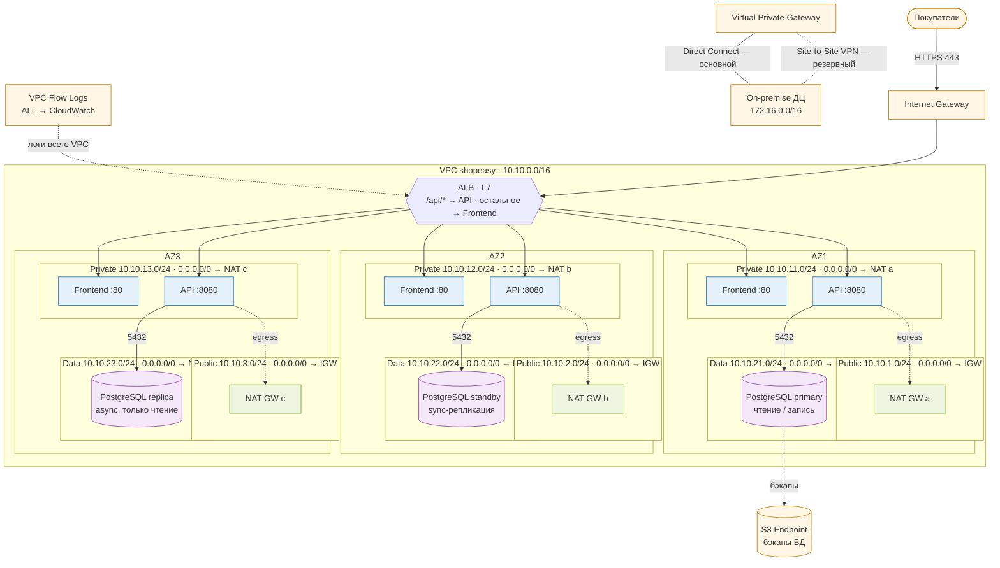

# Organization-and-Management-of-Cloud-Infrastructure

Проект сетевой архитектуры для интернет-магазина ShopEasy, по заданию сделано как проектирование на схеме.

## Описание сервиса

**Название сервиса:** ShopEasy

**Тип сервиса:** интернет-магазин (бытовая техника и электроника)

**Целевая аудитория:** частные покупатели из России

**Основные пользовательские сценарии:**

1. Просмотр каталога и карточек товаров.
2. Вход в личный кабинет.
3. Добавление в корзину и оформление заказа.

**Состав сервисов:**

| Сервис | Назначение | Особенности (что важно для проектирования) |
|---|---|---|
| Веб-фронтенд | публичная часть магазина: каталог, корзина, кабинет | HTTP/HTTPS, порт 80, статика кэшируется |
| API-бэкенд | бизнес-логика: товары, корзина, заказы, авторизация | REST, пути `/api/*`, порт 8080 |
| База данных (PostgreSQL) | хранение товаров, пользователей, заказов | порт 5432, не должна быть доступна из интернета |
| Служебные сервисы | обновления ОС, мониторинг, бэкапы | только исходящий интернет, без входящих соединений |

**Требования к отказоустойчивости:**

- работа в трёх зонах доступности (AZ);
- фронтенд и API отдаются через балансировщик;
- у всех подсетей есть выход в интернет, у приватных и data — только исходящий;
- нет Single Point of Failure.

---

## 1. Обоснование CIDR

**VPC:** `10.10.0.0/16` — 65 536 адресов.

**Почему маска /16:** это стандартный и максимальный размер VPC. Сейчас нужно 9 подсетей (3 AZ × 3 типа), а /16 оставляет большой запас на рост: новые подсети, 4-ю зону, дополнительные сервисы. Маска /20 (минимум) дала бы всего 4096 адресов, расширять VPC потом сложно.

**Существующие сети компании и проверка пересечений:**

| Сеть | CIDR | Пересекается с `10.10.0.0/16`? |
|---|---|---|
| Офис | `192.168.0.0/16` | нет |
| On-premise датацентр | `172.16.0.0/16` | нет |
| VPC тестового окружения | `10.20.0.0/16` | нет |

Не взят `10.0.0.0/16`, потому что это дефолт во многих шаблонах и частая причина конфликтов при соединении сетей.

---

## 2. Таблица подсетей

Логика нумерации третьего октета: `1–3` — публичные, `11–13` — приватные, `21–23` — data.

| Зона | Подсеть | CIDR | Тип | Маршрут по умолчанию |
|---|---|---|---|---|
| AZ1 | публичная | 10.10.1.0/24 | public | IGW |
| AZ1 | приватная | 10.10.11.0/24 | private | NAT GW a |
| AZ1 | data | 10.10.21.0/24 | data | NAT GW a + S3 Endpoint |
| AZ2 | публичная | 10.10.2.0/24 | public | IGW |
| AZ2 | приватная | 10.10.12.0/24 | private | NAT GW b |
| AZ2 | data | 10.10.22.0/24 | data | NAT GW b + S3 Endpoint |
| AZ3 | публичная | 10.10.3.0/24 | public | IGW |
| AZ3 | приватная | 10.10.13.0/24 | private | NAT GW c |
| AZ3 | data | 10.10.23.0/24 | data | NAT GW c + S3 Endpoint |

### Таблицы маршрутизации

**rt-public** — общая для трёх публичных подсетей:

| Назначение | Цель |
|---|---|
| 10.10.0.0/16 | local |
| 0.0.0.0/0 | IGW |

**rt-private-a / b / c** — своя для каждой AZ:

| Назначение | Цель |
|---|---|
| 10.10.0.0/16 | local |
| 172.16.0.0/16 | VGW (on-prem датацентр) |
| 0.0.0.0/0 | NAT GW своей AZ |

**rt-data-a / b / c** — своя для каждой AZ:

| Назначение | Цель |
|---|---|
| 10.10.0.0/16 | local |
| S3 (prefix list) | S3 Gateway Endpoint |
| 0.0.0.0/0 | NAT GW своей AZ |

**Почему для data-подсетей NAT + Endpoint.** Серверам БД нужен исходящий интернет для обновлений ОС и PostgreSQL — это обеспечивает NAT Gateway. Бэкапы БД идут в S3 через Gateway Endpoint: он бесплатный, трафик не выходит в интернет и не оплачивается как трафик через NAT.

---

## 3. Схема сети

В Draw.io было лень рисовать, поэтому выбор пал на Mermaid:

На схеме показаны:

- VPC с тремя AZ, в каждой — public, private и data-подсеть;
- Internet Gateway и ALB с узлами во всех публичных подсетях;
- NAT Gateway в каждой AZ;
- фронтенд и API в приватных подсетях;
- PostgreSQL в data-подсетях: primary, standby и read-replica;
- S3 Endpoint и VPC Flow Logs;
- связь с датацентром: Direct Connect (основной канал) и Site-to-Site VPN (резервный).

---

## 4. Балансировщики

| Сервис | Тип балансировщика | Уровень | Правило / стратегия |
|---|---|---|---|
| Фронтенд и API (публичный вход) | ALB, internet-facing | L7 | `/api/*` → группа API; остальное → группа фронтенда. Фронтенд — Round Robin, API — Least Outstanding Requests |
| Репликация / доступ к БД (если нужен) | NLB, internal | L4 | TCP 5432, flow hash |

**Почему ALB (L7).** Для разделения трафика по путям (`/api/*` и всё остальное) балансировщик должен видеть содержимое HTTP-запроса, а это уровень L7. ALB также принимает HTTPS (сертификат на балансировщике), делает редирект HTTP → HTTPS и распределяет трафик между всеми тремя AZ. NLB (L4) видит только IP и порты, поэтому маршрутизировать по путям не может.

**Health checks:**

| Группа | Порт | Проверка | Интервал / таймаут | Healthy / Unhealthy |
|---|---|---|---|---|
| tg-frontend | 80 | `GET /health` → 200 | 15 с / 5 с | 3 / 2 |
| tg-api | 8080 | `GET /api/health` → 200 | 10 с / 5 с | 3 / 2 |

**Стратегии:**

- **Round Robin** для фронтенда: запросы короткие и одинаковые, инстансы одинаковые — равномерного распределения достаточно.
- **Least Outstanding Requests** для API: запросы разные по длительности (оформление заказа дольше, чем выдача карточки товара). Запрос отправляется на сервер, у которого сейчас меньше незавершённых запросов, — аналог Least Connections для HTTP.

**БД и сырой TCP.** Протокол PostgreSQL — не HTTP, поэтому ALB для него не подходит. Если понадобится балансировать подключения к БД (например, раздавать чтение по репликам), нужен внутренний **NLB (L4)** на TCP 5432 с узлами в data-подсетях. Сама репликация primary → standby/replica идёт напрямую между серверами БД по 5432.

**Контрольная точка 2.** Проверка маршрутизации:

| Запрос | Куда попадёт |
|---|---|
| `GET /` | фронтенд |
| `GET /catalog/phones` | фронтенд |
| `GET /api/products/15` | API |
| `POST /api/orders` | API |

Под `/api/*` попадает только API; у фронтенда нет путей, начинающихся с `/api`, поэтому API не уходит на статику и наоборот.
